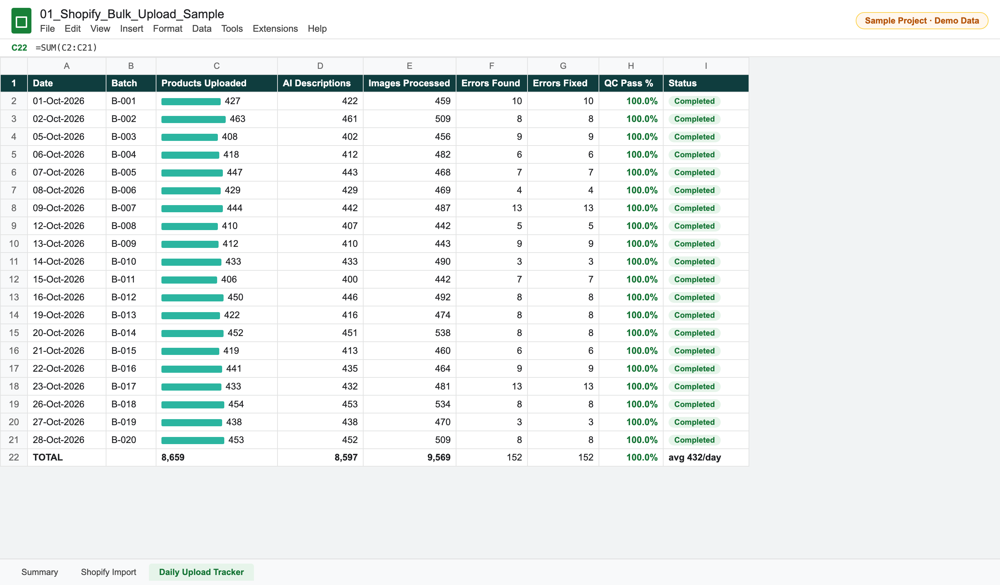

# Sajawal Dastagir · Portfolio

**E-commerce & Shopify Specialist | AI-Assisted Product Operations**

Personal portfolio website showing my skills, experience and work samples: Shopify bulk uploads (400+ products/day), AI product content (Claude, ChatGPT, Gemini), Python web scraping and client spreadsheets.

🔗 **Live site:** _coming soon_

## What's inside

| Work sample | Skills |
|---|---|
| Shopify bulk upload file (420 products) | Shopify, CSV import, SEO |
| Daily upload tracker | Google Sheets / Excel, formulas |
| Python product scraper → Shopify CSV | Python, Requests, BeautifulSoup |
| AI product content (before → after) + prompt library | Claude, ChatGPT, Gemini, content writing |
| Weekly client KPI report | Spreadsheets, conditional formatting |
| SOP: AI-assisted upload workflow | Google Docs, documentation |

> Work samples use demo data to keep client information confidential.

## Built with

Plain **HTML & CSS** (no page builder): responsive layout, dark mode and an image lightbox.

## Contact

- ✉️ sajawalkh121@gmail.com
- 💬 WhatsApp: +92 314 5665459
- 💼 [LinkedIn](https://www.linkedin.com/in/sajawal-khan-b0b693435/)

Open to full-time, visa-sponsored roles worldwide.
